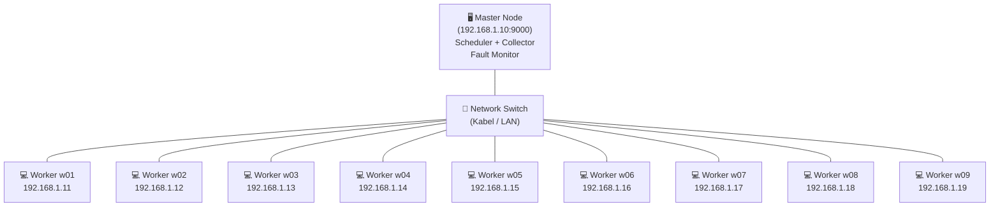
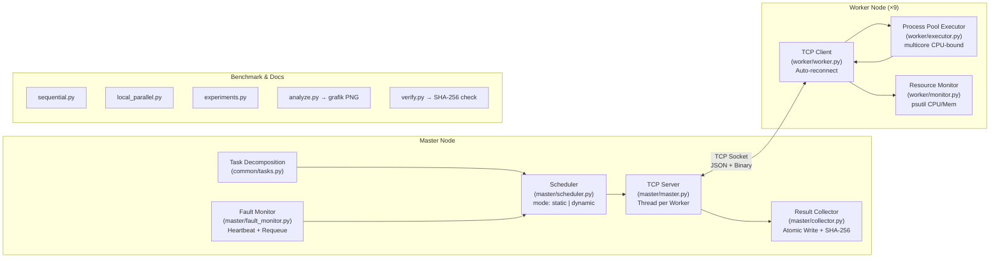
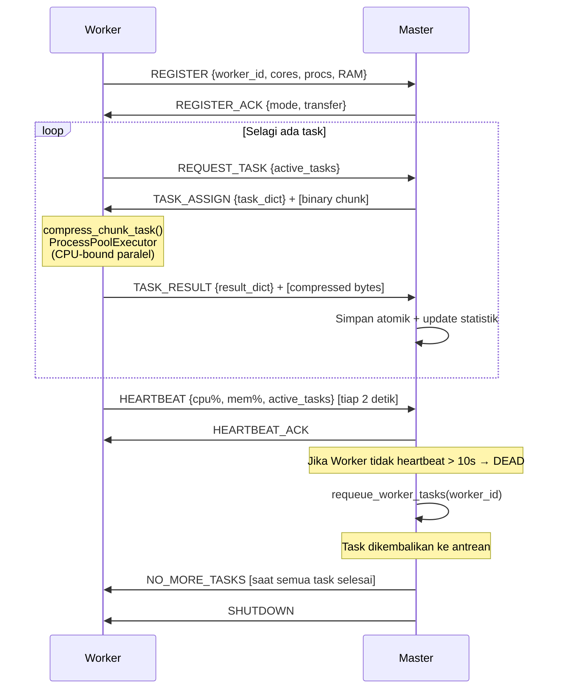
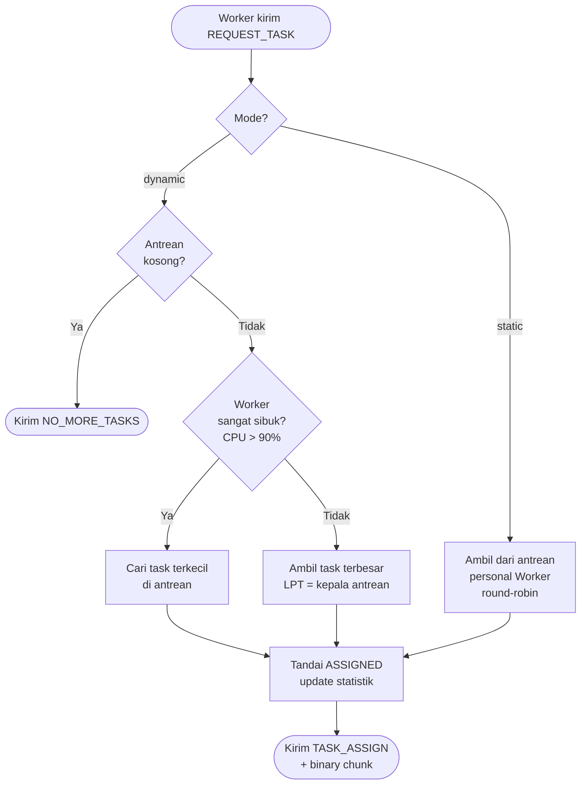

# Arsitektur Sistem – Distributed Data Compression

## Gambaran Umum

Sistem ini menggunakan arsitektur **Master–Worker** untuk kompresi file terdistribusi:
- **1 Master Node**: memecah pekerjaan, mendistribusikan task, mengumpulkan hasil.
- **9 Worker Node**: menerima chunk file, mengompresi secara paralel (multicore), mengembalikan hasil.

---

## Diagram Topologi Jaringan

---

## Arsitektur Komponen

---

## Sequence Diagram Alur Kerja

---

## Flowchart Scheduler (Dynamic Load Balancing)

---

## Komponen Penilaian

| ID | Komponen | Implementasi |
|----|----------|-------------|
| a | Task Decomposition | `common/tasks.py` → `decompose_directory()` |
| b | Parallel Processing | `worker/executor.py` → `ProcessPoolExecutor` |
| c | Distributed Processing | `common/protocol.py`, `master/master.py`, `worker/worker.py` |
| d | Dynamic Load Balancing | `master/scheduler.py` → mode static vs dynamic + LPT |
| e | Fault Tolerance | `master/fault_monitor.py` → heartbeat + requeue + recovery time |
| f | Performance Evaluation | `benchmark/` → sequential, local_parallel, scalability |

---

## Keputusan Desain

| Aspek | Pilihan | Alasan |
|-------|---------|--------|
| Algoritma default | `lzma` preset 6 | CPU-bound terkuat; manfaat paralel paling terlihat |
| Framing TCP | 8-byte length prefix (big-endian uint64) | Mendukung payload hingga 2 GB; sederhana |
| Format transfer | Binary terpisah (bukan base64) | Efisiensi bandwidth; menghindari overhead encoding |
| Load balancing | Pull-based + LPT | Worker cepat otomatis menerima lebih banyak task |
| Idempotency | Cek task_id di set received_ids | Mencegah duplikat dari Worker yang kembali hidup |
| Penulisan output | atomic_write (tmp + rename) | Mencegah file rusak jika Master mati di tengah tulis |
| Pengujian Windows | `freeze_support()` + top-level function | Kompatibel dengan ProcessPoolExecutor di Windows |
